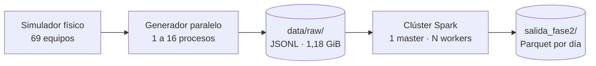

# Proyecto-Generador-de-logs-Crudos-Masivos-para-Puerto-Coquimbo
Proyecto universitario de **Programación Avanzada**. Simula el comportamiento físico de un frente de atraque portuario, genera 10 millones de lecturas de sensores en paralelo y las procesa en un clúster de Apache Spark.

El sitio modelado tiene fajas transportadoras, dos grúas móviles, una báscula de acceso vehicular y un patio de contenedores reefer conectados a la red eléctrica del terminal.

## Contenido

- [Qué hace el proyecto](#qué-hace-el-proyecto)
- [El sitio simulado](#el-sitio-simulado)
- [Formato de los datos](#formato-de-los-datos)
- [Requisitos](#requisitos)
- [Fase 1: generar los datos](#fase-1-generar-los-datos)
- [Fase 2: procesar con PySpark](#fase-2-procesar-con-pyspark)
- [Resultados](#resultados)
- [Estructura del repositorio](#estructura-del-repositorio)
- [Equipo](#equipo)

## Qué hace el proyecto

El trabajo tiene dos fases que se encadenan: la salida de la primera es la entrada de la segunda.



| Fase | Qué hace | Tecnología |
|:---|:---|:---|
| **1 · Generación** | Simula los equipos y escribe 10.000.000 de eventos, midiendo cómo escala el generador con 1, 2, 4, 8 y 16 procesos | Python, solo biblioteca estándar |
| **2 · Procesamiento** | Ingesta, perfila, limpia y analiza los eventos, y los guarda en Parquet particionado | PySpark 4.0.1 sobre Docker |

## El sitio simulado

No es un generador de números al azar: cada equipo recuerda su estado anterior, y de ahí salen la inercia, la deriva y el ruido de las mediciones.

| Familia | Equipos | Métricas | Puntos de medición |
|:---|---:|:---|---:|
| Fajas transportadoras (`FAJA`) | 6 | vibración, corriente | 12 |
| Grúas móviles (`GRUA`) | 2 | corriente, peso | 4 |
| Báscula de acceso (`BASCULA`) | 1 | peso | 1 |
| Contenedores reefer (`REEFER`) | 48 | temperatura, corriente, humedad | 144 |
| Sensores ambientales (`AMB`) | 12 | temperatura, humedad | 24 |
| **Total** | **69** | | **185** |

Cada punto reporta una lectura cada **15 segundos**. Los 10 millones de eventos equivalen a unos 9,4 días de operación a partir del 1 de enero de 2026.

De los 48 reefers, uno de cada cuatro trabaja a +4 °C (carga refrigerada) y el resto a −18 °C (congelado).

## Formato de los datos

Cada evento es un objeto JSON en una línea (formato JSONL):

```json
{"timestamp":"2026-01-01T00:00:00.000Z","sensor_id":"FAJA_S3_C3","metric":"vibration","value":1.773,"unit":"mm/s","worker_id":2}
```

| Campo | Tipo | Descripción |
|:---|:---|:---|
| `timestamp` | texto | Instante de la lectura en UTC, formato ISO 8601 con milisegundos |
| `sensor_id` | texto | Equipo, con la convención `TIPO_SITIO_CORRELATIVO` |
| `metric` | texto | `vibration`, `current`, `weight`, `temperature` o `humidity` |
| `value` | número | Valor medido |
| `unit` | texto | `mm/s`, `A`, `kg`, `C` o `%` |
| `worker_id` | entero | Proceso que generó la lectura; permite auditar el reparto de carga |

Con la misma semilla y el mismo número de procesos, dos ejecuciones producen archivos idénticos.

## Requisitos

| Para | Se necesita |
|:---|:---|
| Fase 1 | Python 3, sin dependencias externas |
| Fase 2 | Docker Desktop con al menos 6 GB de RAM asignados |
| Espacio en disco | Unos 2 GB libres por cada configuración generada |

## Fase 1: generar los datos

```bash
python src/main.py
```

El comando corre la campaña completa de mediciones: genera los 10 millones de eventos con 1, 2, 4, 8 y 16 procesos, cuatro veces cada configuración. Descarta la primera corrida y reporta la mediana de las otras tres. Toma varios minutos.

Al terminar quedan:

- `data/raw/`: una carpeta por configuración (`w01`, `w02`, `w04`, `w08`, `w16`), con un archivo `.jsonl` por proceso (`part-000.jsonl`, `part-001.jsonl`, …). La Fase 2 lee `data/raw/w16/`.
- `bench/mediciones.csv`: tiempos y eventos por segundo de cada configuración.

El generador usa **procesos y no hilos**. El trabajo es cálculo y formateo de texto, y en Python los hilos se turnan un solo núcleo por el GIL; cada proceso tiene su propio intérprete y el paralelismo es real. Cada proceso escribe su propio archivo, así ninguno espera a otro para escribir.

## Fase 2: procesar con PySpark

**1. Configurar el clúster.** Copia la plantilla y ajústala a la RAM de tu Docker:

```bash
cp .env.example .env
```

| RAM de Docker | Workers | Núcleos por worker | Memoria por worker | Memoria del driver |
|:---|---:|---:|---:|---:|
| 6 GB | 2 | 1 | 1 GB | 1 GB |
| 8 GB | 2 | 2 | 2 GB | 2 GB |
| 16 GB | 3 | 2 | 3 GB | 3 GB |
| 32 GB | 4 | 3 | 6 GB | 4 GB |

La regla es que `WORKERS × WORKER_MEMORY + DRIVER_MEMORY` quede holgadamente bajo la RAM de Docker, y que `SPARK_EXECUTOR_MEMORY` no supere a `SPARK_WORKER_MEMORY`.

**2. Levantar el clúster.**

```bash
docker compose up -d --build
```

**3. Verificar que funciona.** La prueba de humo revisa cuatro cosas: sesión, executors, visibilidad de los datos y lectura completa.

```bash
docker compose exec jupyter python3 verificar_cluster.py
```

**4. Abrir el notebook.** Entra a JupyterLab, abre `fase2_pyspark.ipynb` y ejecuta *Restart & Run All*.

| Servicio | Dirección | Notas |
|:---|:---|:---|
| JupyterLab | <http://localhost:8889> | Token: el valor de `JUPYTER_TOKEN` en el `.env` |
| UI del master | <http://localhost:8080> | Workers registrados |
| UI del job | <http://localhost:4040> | Solo mientras hay una sesión de Spark activa |

**5. Apagar.**

```bash
docker compose down
```

### Qué hace el notebook

| Hito | Etapa | Qué resuelve |
|:---:|:---|:---|
| 1 | Ingesta | Lee los JSONL con esquema declarado y mide lo que costaría inferirlo |
| 2 | Perfilado | 27 chequeos de calidad, sin modificar los datos |
| 3 | Limpieza | Marca las líneas defectuosas y las aparta en cuarentena, sin borrarlas |
| 4 | Shuffle | Compara configuraciones de particiones y AQE sobre una misma consulta |
| 5 | Escritura | Parquet particionado por día, releído y verificado |
| 6 | Sesgo y joins | Provoca una clave sesgada y la mitiga con *salting*; compara un join ingenuo con un *range join* |

## Resultados

Medidos en un clúster de 3 workers con 2 núcleos y 3 GB cada uno. Los tiempos varían según el equipo.

| Etapa | Resultado |
|:---|:---|
| Ingesta | 10.000.000 de eventos (1,18 GiB) leídos en 7,9 s; inferir el esquema habría sumado 7,9 s más |
| Perfilado | 27 de 27 chequeos correctos: 0 líneas corruptas, 0 duplicados, 0 huecos |
| Limpieza | 10.000.000 de eventos limpios, balance de conteos verificado |
| Shuffle | De 1,30 s a 0,51 s (2,56×) al ajustar las particiones |
| Escritura | 34,5 MiB en Parquet, 35,2 veces menos que el JSONL |
| Consulta de un día | 1.065.600 filas en 0,12 s, leyendo 1 de 10 carpetas |
| Sesgo | Tarea rezagada de 747 ms reducida a 274 ms con *salting*; consulta 1,27× más rápida |
| Joins | El join ingenuo fabricó 486.486 filas; el *range join* con *broadcast* conservó las 10.000.000 |

## Estructura del repositorio

```text
.
├── src/                      Fase 1
│   ├── main.py               punto de entrada de la campaña de mediciones
│   ├── simulador.py          modelos físicos de los equipos
│   ├── generador.py          bucle de un proceso: reloj, buffer y archivo
│   ├── orquestador.py        reparto entre procesos y medición
│   ├── esquema.py            formato de la línea JSONL
│   ├── reporte.py            tabla final e histórico de mediciones
│   ├── arquitectura_b.py     un proceso y un archivo por worker
│   ├── emisor_tcp.py         variante que envía los eventos por socket
│   └── receptor_tcp.py       variante que los recibe y los escribe
├── bench/                    experimentos y mediciones de rendimiento
├── docker/                   imagen única de Spark para los tres roles
├── docker-compose.yml        clúster: master, workers y Jupyter
├── .env.example              plantilla de recursos del clúster
├── verificar_cluster.py      prueba de humo del clúster
├── fase2_pyspark.ipynb       notebook de la Fase 2, con las celdas Markdown de la presentación
├── img/                      diagrama del clúster y capturas de la UI de Spark que usa el notebook
├── borradores_markdown/      fuente de las celdas Markdown y script que las inserta en el notebook
├── borradores/               resúmenes que genera el propio notebook (hito 6.5)
└── docs/                     informes
```

No se suben al repositorio: `data/raw/` (los datos generados), `salida_fase2/` (la salida de Spark) y `.env`.

## Equipo

Pablo Manque · Ignacio Brizuela · Cristian Rojo · Mauricio Hernandez · Francisco Seura · Raul Muñoz
